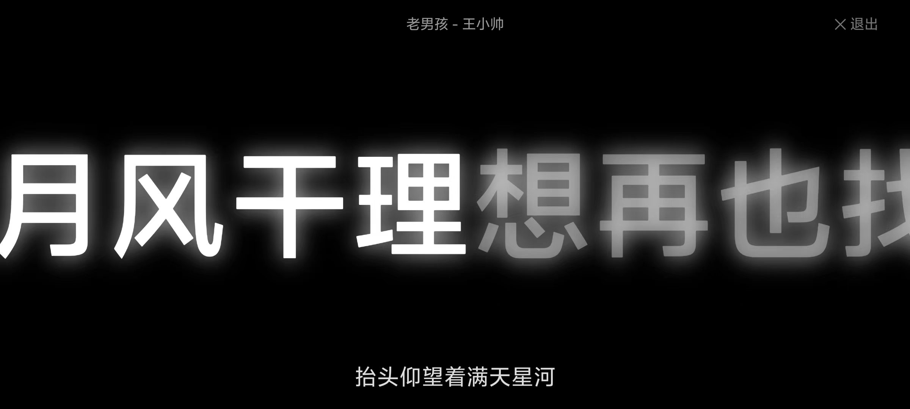
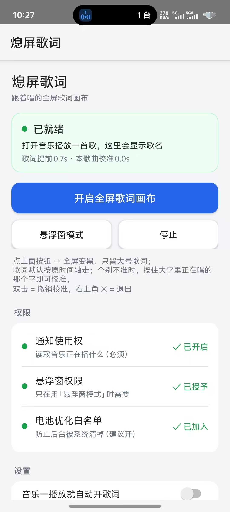

# 基于C++的歌词滚动引擎与实现

一个**纯 C++17** 实现的歌词解析、时间轴同步与连续滚动进度计算引擎。
不依赖任何平台 API 与第三方库，可脱离 Android / 移动端，直接在 PC 上编译、运行与单元测试。
专为「歌词随播放进度**平滑连续**滚动（而非逐行跳变）」这一核心需求设计，并对中文歌词做了 **UTF-8 安全的逐字卡拉OK高亮**。

> 本引擎是 Android 应用「汽水熄屏歌词（SodaLyrics）」的核心算法模块，
> 现独立抽取、优化并文档化，作为 C++ 课程 / 学业报告的可复现工程样例。

---

## 特性

| 特性 | 说明 |
|------|------|
| **纯 C++17** | 仅用标准库（`<string>` `<vector>` `<algorithm>` `<cstdint>`），零第三方依赖、零平台 API |
| **LRC 鲁棒解析** | 多时间标签 `[00:01.00][00:31.00]`、乱序时间轴、`[offset:±N]` 偏移、`[ti:]/[ar:]` 元信息跳过、UTF-8 BOM 与 `\r\n` 兼容 |
| **O(log n) 同步** | 二分查找定位「当前唱到哪一句」，每帧耗时与歌词行数对数相关 |
| **O(1) 连续滚动** | 计算「当前句 → 下一句」的滚动进度（0..1），驱动平滑滚动而非跳变 |
| **边界处理** | 末句无下一句、歌词文件大段空白（间奏/缺失）均不会卡死或错位 |
| **中文 UTF-8 安全** | 按「字符」而非「字节」计数与切片，中文逐字高亮正确 |
| **可测试** | 独立单元测试 `test_engine.cpp`，`g++` 一行命令即可跑全套断言 |

---

## 目录结构

```
基于C++的歌词滚动引擎与实现/
├── README.md                 # 本文件（项目说明 + 算法详解）
├── 报告大纲.md                # 学业报告建议大纲（可直接套用）
├── CMakeLists.txt            # CMake 构建
├── Makefile                  # 通用构建（g++/clang++/cl）
├── include/
│   └── lyrics_engine.h        # 引擎头文件（公开 API）
├── src/
│   ├── lyrics_engine.cpp      # ★ 核心实现（解析 / 同步 / 滚动）
│   └── main.cpp               # 控制台演示（模拟播放 + 卡拉OK高亮）
├── tests/
│   └── test_engine.cpp        # 独立单元测试（g++ 直接编译）
├── jni/
│   └── native-lib.cpp         # 可选：Android JNI 桥接范例（说明如何在 App 中调用）
└── samples/
    └── demo.lrc               # 示例歌词
```

---

## 快速开始

### 方式一：Make（最简单，需 g++/clang++）

```bash
# 编译演示 + 跑测试
make

# 仅运行演示（内置示例；也可传入外部 .lrc 文件）
./demo
./demo samples/demo.lrc

# 仅运行单元测试
make test
```

### 方式二：CMake

```bash
mkdir -p build && cd build
cmake ..
cmake --build .
ctest --output-on-failure      # 运行单元测试
./demo                         # 运行演示
```

### 方式三：一行命令（g++）

```bash
# 演示
g++ -std=c++17 -Iinclude src/main.cpp src/lyrics_engine.cpp -o demo && ./demo

# 测试
g++ -std=c++17 -Iinclude tests/test_engine.cpp src/lyrics_engine.cpp -o test_engine && ./test_engine
```

> Windows 上若用 MinGW / MSYS2，把 `g++` 换成 `g++.exe`；用 MSVC 则用
> `cl /std:c++17 /Iinclude src\main.cpp src\lyrics_engine.cpp`。

---

## 算法详解（核心，适合作报告正文）

### 1. 数据模型

一行歌词抽象为 `LyricLine { int64_t timeMs; std::string text; }`。
解析后得到 `lines_`（原始数组）与一个 `order_`（按 `timeMs` 稳定排序后的**索引表**）。
后续所有查询都通过 `order_` 进行，避免反复排序。

### 2. LRC 解析（有限状态扫描）

逐行读取，对每行从左向右扫描 `[mm:ss.xx]` 时间标签：

- 一个标签解析成功 → 记录时间戳，指针越过 `]`；
- 直到无法解析出标签 → 剩余部分即歌词文本。

支持的时间格式：`[mm:ss.xx]`、`[mm:ss.xxx]`、`[mm:ss:xx]`、`[m:ss]`；
小数部分按位数自动换算为毫秒（2 位→百分秒，3 位→毫秒，1 位→十分之一秒）。
无时间标签的行按元信息处理：`[offset:±N]` 提取全局偏移，其余（`[ti:]` 等）忽略。
创作者信息行（`作词 :`、`作曲：` 等）直接丢弃，避免被当歌词显示导致错位。
空文本行用省略号 `…` 占位，表示间奏。

> **优化点（相较早期版本）**：改用 `std::string` 手工按 `\n` 切分替代 `<sstream>`，
> 天然兼容 `\r\n`；开头自动剥离 UTF-8 BOM；全程移动语义（`std::move`）减少拷贝。

### 3. 时间轴同步（二分查找）

每帧调用 `updatePosition(pos)`，内部先叠加用户偏移 `offsetMs` 得 `positionMs_`，
然后在 `order_` 上执行**二分查找**，定位「最后一个 `timeMs <= positionMs_`」的行：

```cpp
int lo = 0, hi = n - 1, ans = -1;
while (lo <= hi) {
    int mid = (lo + hi) / 2;
    if (lines_[order_[mid]].timeMs <= positionMs_) { ans = mid; lo = mid + 1; }
    else hi = mid - 1;
}
```

复杂度为 **O(log n)**，即使数千行歌词也能每帧瞬时定位。

### 4. 连续滚动进度（O(1)）

当前句起始时间 `curT`，下一句起始时间 `nextT`，跨度 `span = nextT - curT`：

```cpp
progress_ = (positionMs_ - curT) / scrollSpan;   // 夹紧到 [0,1]
```

`progress_` 即「当前句已经唱了多少」，**直接驱动歌词从屏幕下方连续滚到中央**，
而不是逐行跳变——这是「滚动歌词」体验的关键。

### 5. 两个边界（工程经验，报告亮点）

- **最后一句没有下一句**：用默认跨度 `kLastLineSpanMs = 6000ms` 兜底，
  避免超长尾句永远停在开头、后半段滚不出来。
- **歌词文件大段空白**（间奏/缺失，实测可达 40+ 秒）：若空洞超过 `kMaxLineHoldMs = 15000ms`
  且已超过本句时长，判定「本句已结束、下一句未到」，结束本句转为空闲，
  避免画面原地极慢滚动、看起来像卡死。

### 6. UTF-8 逐字卡拉OK高亮

LRC 不含逐字时间戳，故按「滚动进度 × 当前句字符数」估算已唱字符数：

```cpp
int h = round(progress_ * utf8Length(currentText()));
```

其中 `utf8Length` / `utf8Substr` 按 UTF-8 编码规则（非 `0x80` 起始字节即字符起点）
进行**按字符**计数与切片，保证中文字符不会被按字节截断。

---

## 公开 API 一览

| 方法 | 说明 |
|------|------|
| `int loadLrc(const std::string&)` | 解析 LRC，返回有效行数 |
| `int loadPlainLines(lines, durationMs)` | 纯文本模式（均分时间） |
| `void setOffsetMs(int64_t)` / `offsetMs()` | 手动微调偏移 |
| `void updatePosition(int64_t)` | 每帧喂入播放进度 |
| `int currentIndex()` / `float scrollProgress()` | 当前行索引 / 滚动进度 |
| `int highlightedChars()` | 卡拉OK已唱字符数（UTF-8 安全） |
| `currentText()/prevText()/nextText()` | 当前 / 上一 / 下一句 |
| `lastLineTimeMs()/durationMs()/lines()` | 末行时间 / 估算总时长 / 全量歌词 |
| `static utf8Length()/utf8Substr()` | UTF-8 字符计数与切片工具 |

---

## 与 Android 应用的关系

原项目 **SodaLyrics（汽水熄屏歌词）** 是一个 Android App：在听「汽水音乐」时把屏幕压到约 3% 亮度，
用全屏纯黑悬浮窗**平滑滚动**显示歌词。其架构遵循「**纯计算用 C++，必须调系统 API 的用 Java**」：

- **C++（本引擎）**：LRC 解析、时间轴同步、滚动进度——纯逻辑、可独立测试；
- **Java（Android 框架）**：监听 MediaSession、创建悬浮窗、调节亮度、手势——必须调 Android API；
- **JNI（`jni/native-lib.cpp`）**：把本引擎暴露给 Java 层。

本仓库把 C++ 核心**独立抽取**出来，便于在 PC 上学习、编译、测试与作为报告素材，
不再需要 Android Studio / NDK 即可复现全部算法。

---

## 适用与延伸

- **学业报告 / 课程设计**：可直接以本引擎为对象，套用 `报告大纲.md`；
- **二次开发**：把 `Engine` 接入任意播放器 / 网页 / 终端播放器做歌词显示；
- **性能实验**：对比线性扫描 vs 二分查找、稳定性排序 vs 快排，做算法对比实验。

---

## 运行效果（真机截图）

全屏歌词画布，大号歌词随播放进度**连续平滑滚动**，并对中文逐字做卡拉OK高亮（已唱为白、未唱为灰），底部小字为上一句：

| 效果 | 截图 |
|------|------|
| 全屏歌词 · 当前句高亮 + 下一句灰色预告 |  |
| 逐字卡拉OK高亮（已唱白 / 未唱灰） |  |
| App 主界面 · 权限就绪状态与开启入口 |  |

> 截图来自 Android 真机运行「汽水熄屏歌词（SodaLyrics）」App。核心滚动算法即本仓库的 C++ 引擎。

---

## 隐私与免责声明

- 本仓库及附带的安卓应用（`index.html` 内嵌 APK）为**个人学业作品**，**非官方应用**，与汽水音乐、腾讯音乐、网易云音乐等平台均无隶属或合作关系。
- 应用读取媒体播放通知用于歌词显示；为搜索歌词，会将**歌名 / 搜索关键词**发送至第三方公开歌词接口（腾讯、网易云音乐），仅用于获取歌词文本。
- 应用**不收集个人身份信息、设备标识符、通讯录或位置**，**不含广告、统计或崩溃上报 SDK**；除歌词检索外不上传其他数据。
- 歌词版权归各权利人所有，本应用仅作技术演示，不分发歌词内容。
- 核心算法源码已在本仓库完整开源，可自行审阅验证。
- APK 为调试构建（Android Studio 默认 debug 签名），仅供学习演示；请从可信来源获取并安装。
